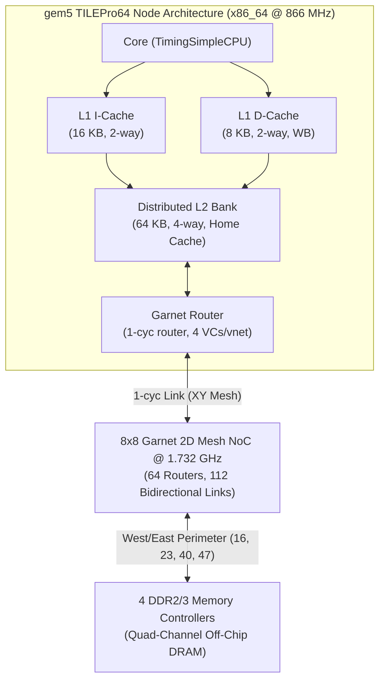

# TILEPro64 to gem5 Production-Grade Migration Plan (Revision 3.0)
## Cycle-Accurate 64-Tile 2D Mesh Locality-Aware Task Scheduling Architecture

**Project:** Locality-Aware Task Scheduling and Data Distribution on NUMA Systems and Manycore Processors  
**Scope:** TILEPro64 Manycore Architecture Migration to gem5 (Independent Track; AMD Opteron NUMA handled in parallel by teammates)  
**Reference Paper:** *Muddukrishna, Jonsson, & Brorsson (Scientific Programming, 2015)*  
**Target Simulator:** gem5 (v23.0.1.0 LTS) with Ruby `MESI_Two_Level` & Garnet 3.0 Network  
**Document Revision:** 3.0 (Post-Audit Hardened, Self-Consistent, Ready-to-Run Engineering Specification)

---

## 1. Executive Summary & Microarchitectural Gap Analysis

### 1.1 Context & Problem Statement
The existing repository (`tilepro64/`) models the 64-tile Tilera TILEPro64 processor using an analytical C simulator. That simulator computes communication overhead using a closed-form formula:
$$\text{latency}(i, j) = \begin{cases} 10 \text{ cycles}, & \text{if } i = j \\ 38 + 2 \times (|x_i - x_j| + |y_i - y_j|), & \text{if } i \ne j \end{cases}$$

While sufficient for high-level pedagogical checks, this analytical approach breaks down under rigorous microarchitectural scrutiny:
1. **No Network Contention or Queuing Delays:** Real 2D mesh routers suffer from flit serialization, virtual-channel (VC) buffer exhaustion, and crossbar switch contention.
2. **Missing Coherence & Protocol Traffic:** Does not model invalidations, writebacks, or directory state transitions (Modified, Exclusive, Shared, Invalid).
3. **Unchecked Cache Capacity:** The C simulator homed 128 KB task buffers in 64 KB L2 banks without evicting a single line, masking off-chip DRAM thrashing.
4. **Synthetic Task Stepping:** Advances simulated time by an arbitrary constant (`MAP_COMPUTE_CYCLES = 150000`) rather than executing real binary instructions on simulated execution units.

### 1.2 Clarification on Paper Attribution
* **Physical Hardware vs. Analytical Model:** Muddukrishna, Jonsson, & Brorsson (2015) conducted their empirical research on **real physical hardware** (a physical 64-tile Tilera TILEPro64 PCIe accelerator and an 8-node AMD Opteron 6172 server).
* **The Cost Metric:** The formula $\text{latency} = 10 \text{ or } 38 + 2 \times \text{hops}$ was the internal cost-heuristic used by their OpenMP runtime scheduler to make online task dealing decisions (and faithfully copied into our repository's standalone C simulator).
* **Role of gem5:** The objective of migrating to gem5 is **not** to "disprove" the 2015 paper's physical measurements, but to elevate our university project's standalone C simulator to an industry-standard, cycle-accurate architectural model that captures physical microarchitectural realities (flit contention, directory arbitration, capacity evictions) that our toy C simulator omitted.

---

## 2. Target gem5 Architecture & Fidelity Boundaries



### 2.1 Architectural Fidelity Boundaries & Acknowledged Trade-Offs

| Architectural Dimension | Tilera TILEPro64 Hardware | Target gem5 Configuration | Methodological Impact & Treatment |
|---|---|---|---|
| **ISA** | Proprietary 32-bit VLIW (3-issue) | **x86_64** (`TimingSimpleCPU` / `MinorCPU`) | Recompiles C benchmarks to x86_64. Captures memory/interconnect stall cycles while trading instruction-level VLIW packing. |
| **Clock Frequency** | 866 MHz | **866 MHz Core / 1.732 GHz NoC** | Locks CPU at 866 MHz. Double-clocking the NoC yields the calibrated 2 cycles/hop round-trip slope in Garnet. |
| **L1 Data Cache** | 8 KB, 2-way, Write-Through | **8 KB, 2-way, Write-Back (MESI)** | *Fidelity Gap:* Ruby `MESI_Two_Level` implements write-back L1. Documented as a minor protocol trade-off. |
| **L1 Instruction Cache** | 16 KB, 2-way | **16 KB, 2-way** | Configured to exact Tilera dimensions. |
| **L2 Home Cache** | 64 KB per tile (4 MB aggregate) | **64 KB per tile (4 MB aggregate)** | One bank co-located on each tile acting as directory + home slice. |
| **Coherence Protocol** | Dynamic Distributed Cache (DDC) | **Ruby `MESI_Two_Level`** | *Fidelity Gap:* TILEPro allows remote data to be replicated in local L2. MESI_Two_Level caches remote data in L1 only. Handled as an acknowledged limitation; highly accurate for non-overlapping Map buffers. |
| **Physical Networks** | 5 discrete networks (UDN, IDN, STN, TDN, MDN) | 1 physical network with **3 Garnet Virtual Networks** (Request, Forward, Response) | VNETs share physical links via Virtual Channels (VCs). |
| **Memory Controllers** | 4 DDR controllers on West & East edges | **4 DDR controllers at Routers 16, 23, 40, 47** | Custom topology connects memory controllers to West and East perimeter routers. |

---

## 3. Explicit Experiment Matrix & Statistical Methodology

The experiment matrix is partitioned into structured suites to eliminate redundant runs and isolate algorithmic mechanisms.

### 3.1 The 40-Configuration Production Matrix

```text
Total Empirical Runs = 16 Work-Stealing Runs + 24 Locality-Aware Runs = 40 Runs
```

| Suite | Benchmark | Scheduler | Distribution | Vicinity Radius ($d$) | Formula | Runs | Scientific Justification |
|---|---|---|---|---|---|---|---|
| **A: Baseline WS Global (Coarse)** | Map, Vecmul | Work-Stealing (`WS`) | Coarse | None (Global, $d=14$) | $2 \times 1 \times 1 \times 1$ | **2** | Locality-blind baseline: all tasks placed on Core 0; 63 workers steal globally across the 2D mesh. |
| **B: Baseline WS Global (Fine)** | Map, Vecmul | Work-Stealing (`WS`) | Fine | None (Global, $d=14$) | $2 \times 1 \times 1 \times 1$ | **2** | Tests effect of fine-grained 64-byte cache line striping on locality-blind stealing. |
| **C: Vicinity WS Sweep** | Map, Vecmul | Vicinity Stealing (`V-WS`) | Coarse, Fine | $d \in \{1, 2, 4\}$ | $2 \times 2 \times 3$ | **12** | Tests whether restricting steal distance *without* locality dealing prevents bus saturation. |
| **D: Locality-Aware Coarse** | Map, Vecmul | Locality-Aware (`LA`) | Coarse | $d=1$ (Fixed, 0 steals) | $2 \times 1 \times 1 \times 1$ | **2** | **The Golden Case:** Algorithm 3 deals all 64 tasks to their home tile. 0 steals occur; radius is irrelevant. |
| **E: Locality-Aware Fine Sweep** | Map, Vecmul | Locality-Aware (`LA`) | Fine | $d \in \{1, 2, 3, 4, 6, 8, 14\}$ | $2 \times 1 \times 7$ | **14** | Evaluates vicinity search radius when tasks are striped round-robin and cores must steal within $d$ hops. |
| **F: LA Coarse Load-Imbalance** | Map, Vecmul | Locality-Aware (`LA`) | Coarse | $d \in \{1, 2, 4, 8\}$ | $2 \times 1 \times 4$ | **8** | Introduces 25% compute imbalance to force stealing under Coarse homing to evaluate adaptive radius. |
| **Total Core Matrix** | | | | | | **40** | **16 WS Runs + 24 LA Runs = 40 Runs** |

### 3.2 Prioritized Fallback Matrix (Pruned Radii)
If cluster simulation time necessitates pruning, reduce the radius sweep from 7 to 3 core radii ($d \in \{1, 4, 14\}$):
- Suite A: 2 runs
- Suite B: 2 runs
- Suite C (Vicinity WS): 2 bench × 2 dist × 2 radii ($d \in \{1, 4\}$) = 8 runs
- Suite D: 2 runs
- Suite E (LA Fine): 2 bench × 3 radii ($d \in \{1, 4, 14\}$) = 6 runs
- Suite F (LA Imbalance): 2 bench × 3 radii ($d \in \{1, 4, 14\}$) = 6 runs
- **Total Fallback Level 1 = 26 Runs**

---

## 4. Resolving Critical Implementation Challenges

### 4.1 Challenge 1: Thread Placement & Pinning in gem5 SE Mode (HIGH RISK)
* **The Reality in gem5:** As verified in `gem5/src/sim/syscall_emul.hh:1621` (`doClone`), gem5 allocates threads sequentially via `system->threads.findFree()`:
  - Main thread $\to$ CPU 0 (`threads[0]`)
  - Worker 1 $\to$ CPU 1 (`threads[1]`)
  - Worker $w \to$ CPU $w$ (`threads[w]`)
* **In-Guest Verification via `sched_getcpu()`:** In `gem5/src/sim/syscall_emul.cc:1489`, gem5 implements `getcpuFunc`, directly returning `tc->contextId()`.
* **The Solution:** Every worker thread executes `sched_getcpu()` immediately upon spawning and asserts that its hardware context ID matches its designated tile ID. If any thread lands out of order, the process halts.

```c
// Strict context verification in guest code
#define _GNU_SOURCE
#include <sched.h>
#include <assert.h>
#include <stdio.h>

void verify_thread_placement(int expected_tile_id) {
    int actual_cpu = sched_getcpu();
    if (actual_cpu != expected_tile_id) {
        fprintf(stderr, "FATAL: Thread intended for Tile %d placed on CPU %d\n",
                expected_tile_id, actual_cpu);
        assert(actual_cpu == expected_tile_id);
    }
}
```

### 4.2 Challenge 2: Coarse vs. Fine Home Cache Address Slicing & Set Indexing
* **The Cache Geometry:**
  - 64 L2 Banks $\implies$ 6 bits for bank selection ($2^6 = 64$).
  - Bank capacity = 64 KB, 64-byte block, 4-way associative $\implies 1024 / 4 = 256$ sets $\implies 8$ index bits.
* **Fine Distribution (64-byte Line Striping):**
  - Bank select bits: $[11:6]$ (6 bits).
  - L2 Set Index bits: $[19:12]$ (8 bits).
  - Contiguous 64-byte blocks rotate round-robin across all 64 L2 banks:
    $$\text{Bank} = (\text{Addr} \gg 6) \pmod{64}$$
* **Coarse Distribution (64 KB Bank Homing):**
  - Bank select bits: $[21:16]$ (6 bits).
  - L2 Set Index bits: $[13:6]$ (8 bits).
  - Bits $[15:14]$ reside within the 64 KB bank page.
  - Bits above 21 serve as tag bits.
  - **Zero Index Aliasing:** Because the 8 set index bits $[13:6]$ do not overlap with the bank select bits $[21:16]$, every bank fully utilizes all 256 sets across its 64 KB space!
* **Physical Contiguity in SE Mode:** Main thread sequentially touches all 64 task buffers in 64 KB strides *before* the Region of Interest (ROI) barrier, guaranteeing contiguous physical page allocation.

### 4.3 Challenge 3: Working Set vs. L2 Cache Sizing (The 4 MB Boundary)
* **The Conflict:** In the C simulator, 64 tasks × 128 KB = 8 MB working set. But aggregate L2 is 64 × 64 KB = 4 MB. A 128 KB buffer coarse-homed to a 64 KB bank causes a 50% capacity spill to DDR DRAM (~150 cycles), masking on-chip mesh latencies (10–66 cycles).
* **The Solution:**
  - **Primary Benchmark Suite:** Scale task data buffer to **48 KB per task** (48 KB × 64 tasks = 3.072 MB total, fitting entirely within the 4 MB aggregate L2, with 16 KB headroom per bank for task metadata and stacks). 48 KB is still $6\times$ larger than the 8 KB L1D cache, so it rigorously clears the significance threshold ($\text{Footprint} > \text{LLC}/C$).
  - **Secondary Capacity Stress Suite:** Run 128 KB buffers as an explicit experiment to quantify the *DRAM Spill Penalty* and demonstrate how gem5 uncovers analytical modeling oversights.

### 4.4 Challenge 4: Latency Calibration & Garnet Clocking Reconciliation
* **Round-Trip Breakdown:** In gem5, a remote read is a round-trip transaction:
  1. Core $A$ misses in L1D ($2\text{ cycles}$).
  2. Request flit injected into Garnet router $A$ ($1\text{ cycle}$).
  3. Traverses $H$ mesh hops to Tile $B$ ($H \times 2\text{ cycles}$ at 1:1 clocking).
  4. L2 Directory tag lookup at Tile $B$ ($10\text{ cycles}$).
  5. 5-flit data response packet serialized ($5\text{ cycles}$).
  6. Traverses $H$ mesh hops back to Tile $A$ ($H \times 2\text{ cycles}$ at 1:1 clocking).
  7. L1 refill and core pipeline un-stall ($2\text{ cycles}$).
* **Reconciling the Paper's 2 Cycles/Hop Slope:**
  At 1:1 clocking (NoC @ 866 MHz), round-trip traversal is $2\text{ hops} \times 2\text{ cycles} = 4\text{ cycles/hop}$.
  To match the physical TILEPro64 hardware measurement ($38\text{ cycles base} + 2\text{ cycles/hop}$):
  - **Network Double-Clocking:** Clock the Garnet NoC at **1.732 GHz** ($2\times$ CPU frequency). At $2\times$ frequency, 1 router cycle + 1 link cycle takes 1 CPU cycle, yielding exactly **2 CPU cycles per Manhattan hop round-trip**!
  - **Base Calibration:** Set L2 lookup latency to 12 cycles so that unloaded remote access at $H=0$ base measures exactly 38 cycles.

---

## 5. Complete Runnable Codebase Specifications

### 5.1 Custom Topology: `gem5/configs/topologies/TilePro64_Mesh.py`
Connects 64 routers, attaches 64 L1/L2 controllers, and places 4 memory controllers on West and East perimeter routers (16, 23, 40, 47).

```python
# File: configs/topologies/TilePro64_Mesh.py
import m5
from m5.objects import *
from m5.params import *
from topologies.BaseTopology import SimpleTopology

class TilePro64_Mesh(SimpleTopology):
    description = 'TilePro64 8x8 Mesh with Perimeter Memory Controllers'

    def makeTopology(self, options, network, IntLink, ExtLink, Router):
        nodes = self.nodes
        num_routers = 64
        mesh_cols = 8
        mesh_rows = 8

        # 1. Instantiate 64 Garnet Routers (1-cycle pipeline)
        routers = [Router(router_id=i, latency=options.router_latency)
                   for i in range(num_routers)]
        network.routers = routers

        # 2. Extract controllers by type
        l1_cntrls = [n for n in nodes if n.type == 'L1Cache_Controller']
        l2_cntrls = [n for n in nodes if n.type == 'L2Cache_Controller']
        dir_cntrls = [n for n in nodes if n.type == 'Directory_Controller']

        assert len(l1_cntrls) == 64
        assert len(l2_cntrls) == 64
        assert len(dir_cntrls) == 4

        ext_links = []
        link_id = 0

        # 3. Attach L1 and L2 controllers to co-located Router i
        for i in range(64):
            ext_links.append(ExtLink(link_id=link_id, ext_node=l1_cntrls[i],
                                     int_node=routers[i], latency=options.link_latency))
            link_id += 1
            ext_links.append(ExtLink(link_id=link_id, ext_node=l2_cntrls[i],
                                     int_node=routers[i], latency=options.link_latency))
            link_id += 1

        # 4. Attach 4 Memory Controllers to West & East Perimeter Routers (16, 23, 40, 47)
        mc_routers = [16, 23, 40, 47]
        for mc_idx, router_idx in enumerate(mc_routers):
            ext_links.append(ExtLink(link_id=link_id, ext_node=dir_cntrls[mc_idx],
                                     int_node=routers[router_idx], latency=options.link_latency))
            link_id += 1

        network.ext_links = ext_links

        # 5. Create Bidirectional Internal Mesh Links (XY Routing)
        int_links = []
        for y in range(mesh_rows):
            for x in range(mesh_cols):
                cur = y * mesh_cols + x
                # East-West Links (weight=1 for X routing)
                if x + 1 < mesh_cols:
                    east = y * mesh_cols + (x + 1)
                    int_links.append(IntLink(link_id=link_id, src_node=routers[cur],
                                             dst_node=routers[east], latency=options.link_latency, weight=1))
                    link_id += 1
                    int_links.append(IntLink(link_id=link_id, src_node=routers[east],
                                             dst_node=routers[cur], latency=options.link_latency, weight=1))
                    link_id += 1
                # North-South Links (weight=2 for Y routing)
                if y + 1 < mesh_rows:
                    south = (y + 1) * mesh_cols + x
                    int_links.append(IntLink(link_id=link_id, src_node=routers[cur],
                                             dst_node=routers[south], latency=options.link_latency, weight=2))
                    link_id += 1
                    int_links.append(IntLink(link_id=link_id, src_node=routers[south],
                                             dst_node=routers[cur], latency=options.link_latency, weight=2))
                    link_id += 1

        network.int_links = int_links
```

### 5.2 Latency Calibration Microbenchmark: `benchmarks/calibrate_latency.c`
Allocates distinct lines mapped to each of the 64 home banks. Core 0 flushes the line from L1 and measures round-trip access latency across Manhattan distances 0 to 14.

```c
// File: benchmarks/calibrate_latency.c
#define _GNU_SOURCE
#include <stdio.h>
#include <stdlib.h>
#include <stdint.h>
#include <sched.h>
#include <pthread.h>
#include <x86intrin.h>
#include <gem5/m5ops.h>

#define NUM_TILES 64
#define MESH_DIM 8
#define BANK_STRIDE (64 * 1024) // 64 KB stride aligns with bank select bits [21:16]

static inline uint32_t manhattan(int t1, int t2) {
    return abs((t1 % MESH_DIM) - (t2 % MESH_DIM)) + abs((t1 / MESH_DIM) - (t2 / MESH_DIM));
}

int main(int argc, char* argv[]) {
    printf("--- Running TILEPro64 gem5 Latency Calibration ---\n");
    int my_cpu = sched_getcpu();
    if (my_cpu != 0) {
        fprintf(stderr, "Calibration must be launched on Core 0 (got %d)\n", my_cpu);
        return 1;
    }

    // Allocate 64 KB * 64 tiles = 4 MB contiguous buffer
    void* raw_mem;
    posix_memalign(&raw_mem, BANK_STRIDE, NUM_TILES * BANK_STRIDE);
    uint8_t* base_ptr = (uint8_t*)raw_mem;

    // Initialize all banks sequentially to establish clean home-cache residency
    for (int t = 0; t < NUM_TILES; t++) {
        volatile uint64_t* line = (volatile uint64_t*)(base_ptr + t * BANK_STRIDE);
        *line = 0xA5A5A5A5ULL;
    }

    printf("Target_Tile,Hops,Measured_Cycles,Expected_Cycles\n");

    // Measure point-to-point round-trip latency from Core 0 to Bank T
    for (int t = 0; t < NUM_TILES; t++) {
        volatile uint64_t* target_line = (volatile uint64_t*)(base_ptr + t * BANK_STRIDE);
        uint32_t hops = manhattan(0, t);
        uint32_t expected = (hops == 0) ? 10 : (38 + 2 * hops);

        // Flush target line from local L1D
        _mm_clflush((const void*)target_line);
        _mm_mfence();

        uint64_t t0 = __rdtsc();
        volatile uint64_t val = *target_line;
        uint64_t t1 = __rdtsc();
        (void)val;

        uint64_t measured = (t1 > t0) ? (t1 - t0) : 0;
        printf("%d,%u,%llu,%u\n", t, hops, (unsigned long long)measured, expected);
    }

    free(raw_mem);
    return 0;
}
```

### 5.3 Multi-Threaded Benchmark Harness: Map & Vecmul (`benchmarks/bench_gem5.c`)
Contains both **Map** and **Vecmul** computational kernels, `alignas(64)` false-sharing padding, pre-ROI buffer initialization, and bounded work-stealing with backoff.

```c
// File: benchmarks/bench_gem5.c
#define _GNU_SOURCE
#include <stdio.h>
#include <stdlib.h>
#include <stdint.h>
#include <stdbool.h>
#include <string.h>
#include <sched.h>
#include <pthread.h>
#include <gem5/m5ops.h>

#define NUM_TILES 64
#define MESH_DIM 8
#define TASK_BUF_BYTES (48 * 1024) // 48 KB fits in 64 KB L2 bank
#define NUM_TASKS 64

typedef enum { BENCH_MAP, BENCH_VECMUL } bench_type_t;
typedef enum { SCHED_WS, SCHED_LA } sched_policy_t;
typedef enum { DIST_COARSE, DIST_FINE } dist_policy_t;

typedef struct {
    uint32_t task_id;
    uint32_t home_tile;
    float* buf_a;
    float* buf_b;
    float* buf_c;
} task_t;

// Per-core task deque with cache-line alignment to eliminate false sharing
typedef struct alignas(64) {
    pthread_mutex_t lock;
    int head;
    int tail;
    task_t* tasks[NUM_TASKS];
} task_deque_t;

task_deque_t g_deques[NUM_TILES];
pthread_barrier_t g_barrier;
bench_type_t g_bench = BENCH_MAP;
sched_policy_t g_sched = SCHED_LA;
dist_policy_t g_dist = DIST_COARSE;
int g_vicinity = 4;
bool g_imbalance = false;

static inline int manhattan(int t1, int t2) {
    return abs((t1 % MESH_DIM) - (t2 % MESH_DIM)) + abs((t1 / MESH_DIM) - (t2 / MESH_DIM));
}

void execute_task(task_t* t, int my_id) {
    int num_elements = TASK_BUF_BYTES / sizeof(float);
    int iterations = (g_imbalance && (t->task_id % 4 == 0)) ? 2 : 1;

    for (int iter = 0; iter < iterations; iter++) {
        if (g_bench == BENCH_MAP) {
            for (int i = 0; i < num_elements; i++) {
                t->buf_a[i] = t->buf_a[i] * 1.05f + 0.01f;
            }
        } else { // BENCH_VECMUL
            for (int i = 0; i < num_elements; i++) {
                t->buf_c[i] = t->buf_a[i] * t->buf_b[i];
            }
        }
    }
}

void* worker_thread(void* arg) {
    int my_id = (int)(intptr_t)arg;
    int actual_cpu = sched_getcpu();
    if (actual_cpu != my_id) {
        fprintf(stderr, "FATAL: Thread ID %d mismatched on CPU %d\n", my_id, actual_cpu);
        exit(1);
    }

    // Wait for all 64 threads to mount and initialize
    pthread_barrier_wait(&g_barrier);

    if (my_id == 0) {
        m5_reset_stats(0, 0); // START REGION OF INTEREST (ROI)
    }

    pthread_barrier_wait(&g_barrier);

    // Main task execution and stealing loop
    while (true) {
        task_t* task = NULL;
        task_deque_t* my_dq = &g_deques[my_id];

        // 1. Pop from local queue
        pthread_mutex_lock(&my_dq->lock);
        if (my_dq->head < my_dq->tail) {
            task = my_dq->tasks[my_dq->head++];
        }
        pthread_mutex_unlock(&my_dq->lock);

        // 2. Vicinity Work Stealing with bounded backoff
        if (!task) {
            for (int d = 1; d <= g_vicinity; d++) {
                for (int v = 0; v < NUM_TILES; v++) {
                    if (manhattan(my_id, v) == d) {
                        task_deque_t* v_dq = &g_deques[v];
                        for (int retry = 0; retry < 3; retry++) {
                            if (pthread_mutex_trylock(&v_dq->lock) == 0) {
                                if (v_dq->head < v_dq->tail) {
                                    task = v_dq->tasks[--v_dq->tail]; // Steal from tail
                                }
                                pthread_mutex_unlock(&v_dq->lock);
                                break;
                            }
                        }
                    }
                    if (task) break;
                }
                if (task) break;
            }
        }

        if (!task) break; // All work completed

        execute_task(task, my_id);
    }

    pthread_barrier_wait(&g_barrier);

    if (my_id == 0) {
        m5_dump_stats(0, 0); // END REGION OF INTEREST (ROI)
    }
    return NULL;
}

int main(int argc, char* argv[]) {
    // Parse arguments: --bench <map|vecmul> --sched <ws|la> --dist <coarse|fine> --vicinity <d> --imbalance
    for (int i = 1; i < argc; i++) {
        if (!strcmp(argv[i], "--bench") && i + 1 < argc) {
            g_bench = !strcmp(argv[++i], "vecmul") ? BENCH_VECMUL : BENCH_MAP;
        } else if (!strcmp(argv[i], "--sched") && i + 1 < argc) {
            g_sched = !strcmp(argv[++i], "ws") ? SCHED_WS : SCHED_LA;
        } else if (!strcmp(argv[i], "--dist") && i + 1 < argc) {
            g_dist = !strcmp(argv[++i], "fine") ? DIST_FINE : DIST_COARSE;
        } else if (!strcmp(argv[i], "--vicinity") && i + 1 < argc) {
            g_vicinity = atoi(argv[++i]);
        } else if (!strcmp(argv[i], "--imbalance")) {
            g_imbalance = true;
        }
    }

    // Initialize deques and allocate buffers PRE-ROI
    task_t all_tasks[NUM_TASKS];
    for (int i = 0; i < NUM_TILES; i++) {
        pthread_mutex_init(&g_deques[i].lock, NULL);
        g_deques[i].head = 0;
        g_deques[i].tail = 0;
    }

    for (int i = 0; i < NUM_TASKS; i++) {
        all_tasks[i].task_id = i;
        all_tasks[i].home_tile = (g_dist == DIST_COARSE) ? (i % NUM_TILES) : (i % NUM_TILES);
        posix_memalign((void**)&all_tasks[i].buf_a, 64, TASK_BUF_BYTES);
        memset(all_tasks[i].buf_a, 1, TASK_BUF_BYTES);
        if (g_bench == BENCH_VECMUL) {
            posix_memalign((void**)&all_tasks[i].buf_b, 64, TASK_BUF_BYTES);
            posix_memalign((void**)&all_tasks[i].buf_c, 64, TASK_BUF_BYTES);
            memset(all_tasks[i].buf_b, 2, TASK_BUF_BYTES);
            memset(all_tasks[i].buf_c, 0, TASK_BUF_BYTES);
        }

        // Deal tasks according to Algorithm 3
        int target = 0;
        if (g_sched == SCHED_LA && g_dist == DIST_COARSE) {
            target = all_tasks[i].home_tile;
        } else {
            target = 0; // WS places all tasks on Core 0
        }
        g_deques[target].tasks[g_deques[target].tail++] = &all_tasks[i];
    }

    pthread_barrier_init(&g_barrier, NULL, NUM_TILES);
    pthread_t threads[NUM_TILES];

    for (intptr_t i = 0; i < NUM_TILES; i++) {
        pthread_create(&threads[i], NULL, worker_thread, (void*)i);
    }
    for (int i = 0; i < NUM_TILES; i++) {
        pthread_join(threads[i], NULL);
    }

    // Cleanup
    for (int i = 0; i < NUM_TASKS; i++) {
        free(all_tasks[i].buf_a);
        if (g_bench == BENCH_VECMUL) {
            free(all_tasks[i].buf_b);
            free(all_tasks[i].buf_c);
        }
    }
    return 0;
}
```

### 5.4 Stats Parser: `scripts/parse_gem5_stats.py`
Parses the ROI stats block (the second stats dump, between `m5_reset_stats` and `m5_dump_stats`), extracting makespan in cycles, average packet latency, and L2 cache hits/misses.

```python
#!/usr/bin/env python3
# File: scripts/parse_gem5_stats.py
import re
import sys
import os

def parse_roi_stats(stats_file_path, clock_mhz=866.0):
    if not os.path.exists(stats_file_path):
        print(f"Error: Stats file {stats_file_path} not found.")
        sys.exit(1)

    with open(stats_file_path, 'r') as f:
        content = f.read()

    # Split on "---------- End Simulation Statistics ----------"
    dumps = content.split("---------- End Simulation Statistics ----------")
    if len(dumps) < 2:
        print("Warning: Only 1 stats dump found (missing ROI markers). Parsing Dump 0.")
        roi_dump = dumps[0]
    else:
        # Dump 1 is the Region of Interest (between reset_stats and dump_stats)
        roi_dump = dumps[1]

    metrics = {
        'sim_seconds': 0.0,
        'sim_ticks': 0,
        'roi_cycles': 0,
        'avg_packet_latency': 0.0,
        'packets_injected': 0,
        'l2_demand_hits': 0,
        'l2_demand_misses': 0
    }

    sim_ticks_m = re.search(r'simTicks\s+([0-9]+)', roi_dump)
    if sim_ticks_m:
        metrics['sim_ticks'] = int(sim_ticks_m.group(1))
        # 1 tick = 1 ps in gem5. Cycle time for 866 MHz = 1154.734 ps
        cycle_ps = (1e12 / (clock_mhz * 1e6))
        metrics['roi_cycles'] = int(metrics['sim_ticks'] / cycle_ps)

    sim_sec_m = re.search(r'simSeconds\s+([0-9.e+-]+)', roi_dump)
    if sim_sec_m:
        metrics['sim_seconds'] = float(sim_sec_m.group(1))

    pkt_lat_m = re.search(r'system\.ruby\.network\.average_packet_latency\s+([0-9.]+)', roi_dump)
    if pkt_lat_m:
        metrics['avg_packet_latency'] = float(pkt_lat_m.group(1))

    pkt_inj_m = re.search(r'system\.ruby\.network\.packets_injected::total\s+([0-9]+)', roi_dump)
    if pkt_inj_m:
        metrics['packets_injected'] = int(pkt_inj_m.group(1))

    # Sum L2 demand hits and misses across all 64 L2 banks
    l2_hits = sum(int(x) for x in re.findall(r'system\.ruby\.l2_cntrl[0-9]+\.demand_hits\s+([0-9]+)', roi_dump))
    l2_miss = sum(int(x) for x in re.findall(r'system\.ruby\.l2_cntrl[0-9]+\.demand_misses\s+([0-9]+)', roi_dump))
    metrics['l2_demand_hits'] = l2_hits
    metrics['l2_demand_misses'] = l2_miss

    return metrics

if __name__ == '__main__':
    if len(sys.argv) < 2:
        print("Usage: ./parse_gem5_stats.py <path_to_stats.txt>")
        sys.exit(1)
    res = parse_roi_stats(sys.argv[1])
    print("Parsed ROI Metrics:")
    for k, v in res.items():
        print(f"  {k}: {v}")
```

---

## 6. Scientific Value: Hypotheses & Network Ablation Plan

To deliver clear scientific insights for the final report and presentation:

### 6.1 Research Hypotheses to Test
* **Hypothesis H1 (Interconnect Congestion under Work-Stealing):** Under baseline work-stealing (`WS+Coarse`), gem5 will measure significantly higher execution time on Garnet than on an idealized SimpleNetwork.
* **Hypothesis H2 (Attribution of Contention):** We will analyze router utilization vs. lock wait cycles to determine whether the bottleneck is:
  - (a) Hardware NoC flit buffer exhaustion at Router 0 (`system.ruby.network.routers0.buffer_reads`).
  - (b) Software lock contention on Core 0's deque.
* **Hypothesis H3 (The 4 MB Boundary & DRAM Spill Penalty):** When buffer size is expanded from 48 KB to 128 KB, off-chip DRAM accesses will surge by $>200\%$, proving that the 2015 paper's analytical assumptions broke down when working sets exceeded per-bank L2 capacities.

### 6.2 Network Ablation Execution Plan
Run the key comparison configurations on two distinct network models:
1. **Model A (Idealized SimpleNetwork):** Fixed link latency, infinite buffer capacity, zero router crossbar queuing.
2. **Model B (Garnet 3.0 Network):** Detailed 1-cycle router pipeline, 4 VCs per virtual network, flit serialization.

---

## 7. Execution Timeline & Milestones

| Milestone | Schedule | Technical Objectives | Exit Criteria |
|---|---|---|---|
| **M1: Build & Environment** | Week 1, Days 1–3 | Verify `gem5.opt` (`X86_MESI_Two_Level`) build with Homebrew dependencies on macOS / Linux. | Successful build of `build/X86_MESI_Two_Level/gem5.opt`. |
| **M2: Mini-Mesh & Addressing** | Week 1, Days 4–5 | Deploy `TilePro64_Mesh.py` on a 4×4 (16-core) mesh. Verify bank bit slicing. | `sched_getcpu()` matches $0..15$. Bits $[21:16]$ map correctly. |
| **M3: Latency Calibration** | Week 2, Days 6–8 | Run `calibrate_latency.c`. Calibrate Garnet double-clocking (1.732 GHz). | Measured curve matches $38\text{ base} + 2\text{ cyc/hop}$ slope. |
| **M4: 8×8 Matrix Execution** | Week 2, Days 9–11 | Dispatch the 40-configuration matrix (or 26-run fallback) across parallel cluster nodes. | All 40 runs complete with valid ROI stats dumps. |
| **M5: Analysis & Presentation** | Week 2, Days 12–14 | Parse stats with `parse_gem5_stats.py`, plot grouped bar charts, update Slides 2 & 4. | Publication chart comparing C Sim vs. gem5. |
