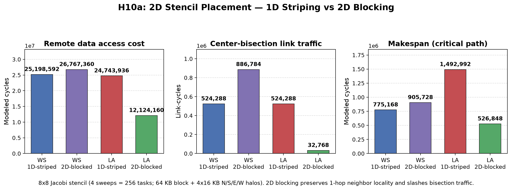

# H10a: 2D Stencil Placement Mismatch (1D Striping vs 2D Blocking)

## Policy & Workload

Fine distribution (`1d_striped`) interleaves cache lines linearly across all 64 tiles, destroying 2D row/column spatial locality for matrix stencils. `2d_block` maps an 8×8 task grid `(tx, ty)` directly onto the 8×8 physical tile coordinates `(tx, ty)` so each task's 64 KB interior block resides locally while its four 16 KB neighbor halo edges (North, South, East, West) sit strictly **1 Manhattan hop** away.

The H10a workload runs **4 Jacobi sweeps** (64 tasks per sweep = **256 tasks total**) and models:
- **Remote data access cost** (`simulated_communication_cost`)
- **Center-bisection link traffic** (`congestion_queue_cycles`, summing flit-cycles crossing the central vertical `x=3↔4` and horizontal `y=3↔4` bisection links under deterministic XY routing)
- **Makespan** (`simulated_execution_time`, critical-path tile cycles + max link busy cycles)



## Results

| Config | Comm cost (cycles) | Center-bisection traffic | Max link busy | Makespan (cycles) | Steals |
|---|---:|---:|---:|---:|---:|
| **WS + 1D-striped** | 25,198,592 | 524,288 link-cycles | 32,768 | 775,168 | 252 |
| **WS + 2D-blocked** | 26,767,360 | 886,784 link-cycles | 63,488 | 905,728 | 252 |
| **LA + 1D-striped** | 24,743,936 | 524,288 link-cycles | 49,152 | 1,492,992 | 248 |
| **LA + 2D-blocked** | **12,124,160** | **32,768 link-cycles** | **2,048** | **526,848** | **0** |

## Interpretation

1. **1D striping defeats locality dealing (`LA + 1D-striped`):** Because linear cache-line striping spreads bytes evenly across all 64 homes, every tile sees identical communication cost (`argmax` breaks ties arbitrarily), causing 248 steals and 524K center-bisection link-cycles.
2. **Data layout and scheduler must match (`WS + 2D-blocked` vs `LA + 2D-blocked`):** Blocking data in 2D *without* locality-aware placement (`WS + 2D-blocked`) actually worsens center-bisection congestion (`886K` link-cycles) because random workers drag entire 64 KB blocks across the mesh bisection. Combining 2D blocking with Locality-Aware dealing (`LA + 2D-blocked`) cuts remote comm cost by **51.0%**, slashes center-bisection link traffic by **93.8% (16×)**, eliminates all remote steals (`256/256` local), and speeds up makespan by **2.83× (−64.7%)**.

## Reproduce

```sh
bin/tilepro64 --benchmark h10a --scheduler ws --dist 1d_striped --csv
bin/tilepro64 --benchmark h10a --scheduler la --dist 1d_striped --csv
bin/tilepro64 --benchmark h10a --scheduler la --dist 2d_block --csv
python3 scripts/plot_h10a_comparison.py
```
