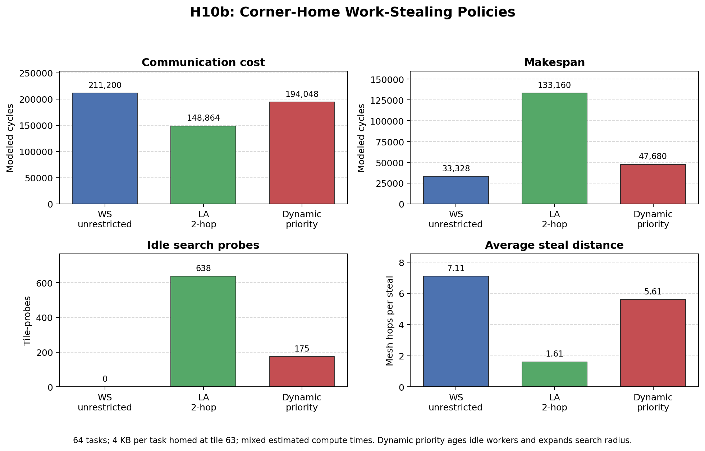

# H10b Dynamic Idle-Age and Remaining-Time Stealing

## Policy

The new `dp` policy implements the proposed idea: an idle tile gains urgency, and it estimates each queued task's remaining completion time before stealing it.

For each candidate task, the scheduler estimates:

\[\text{ETA}(task, worker)=\text{task compute cycles}+\text{modeled data-access cost at worker}.\]

It then scores candidates using estimated completion time, the estimated cost of reaching the queue, the number of tasks remaining in the batch, and the worker's idle age. The score favors longer remaining tasks as the batch approaches completion, while the idle-age term makes distant work increasingly attractive after a worker has failed to find nearby work. The search radius starts at one hop and grows by three hops per unsuccessful scheduling round, capped at the mesh diameter of 14 hops. Within the eligible queues, the policy inspects tasks and steals the highest-scoring task rather than blindly taking the queue tail.

This is a deterministic scheduling heuristic. An “idle round” is one unsuccessful scheduler pass, not a calibrated number of hardware cycles.

## Benchmark trace

The H10b workload creates 64 independent tasks and places each task's 4 KB footprint at tile 63. Eight tasks have 30,000 modeled compute cycles; the rest have 5,000. The compared policies use the same tasks and data homes:

- **WS:** unrestricted work stealing.
- **LA:** fixed two-hop vicinity search.
- **DP:** dynamic priority stealing with idle-age expansion and remaining-time scoring.



## Results

| Policy | Communication cost | Makespan | Idle search probes | Avg. steal distance | Steals |
|---|---:|---:|---:|---:|---:|
| WS unrestricted | 211,200 cycles | 33,328 cycles | 0 | 7.11 hops | 63 |
| LA, 2-hop | 148,864 cycles | 133,160 cycles | 638 | 1.61 hops | 54 |
| Dynamic priority | 194,048 cycles | 47,680 cycles | 175 | 5.61 hops | 61 |

On this trace, DP reduces LA's makespan by about 64% while using a wider search radius. Relative to WS, DP reduces modeled communication cost by about 8%, but its makespan is about 43% higher. WS spreads work across the mesh immediately and wins makespan here; DP retains more locality than WS and performs much better than the restrictive two-hop LA policy.

## Interpretation

The result shows the tradeoff the policy is meant to address: fixed short-range stealing avoids remote accesses but leaves faraway workers idle; unrestricted stealing balances work quickly but can move tasks far from their data. Dynamic aging expands the search as workers wait and ranks work by estimated remaining completion time. In this experiment it is a middle ground, not a universal winner.

## Limitations

- The workload is synthetic and has no task dependencies.
- Tasks are atomic; remaining time is estimated before execution rather than updated from measured partial progress.
- Idle age counts scheduling rounds, not elapsed idle cycles.
- The simulator's makespan adds each tile's modeled task costs but does not perform a cycle-accurate event simulation of worker completion and wake-up.
- Cache behavior, steal-operation latency, network contention, and bandwidth are simplified.

Treat these results as a policy prototype. A stronger evaluation should use real task traces, nonuniform task durations, dependencies, and a timed event simulation that advances workers as tasks complete.

## Reproduce

```sh
bin/tilepro64 --benchmark h10b --scheduler ws --csv
bin/tilepro64 --benchmark h10b --scheduler la --vicinity 2 --csv
bin/tilepro64 --benchmark h10b --scheduler dp --csv
python scripts/plot_h10b_comparison.py
```
