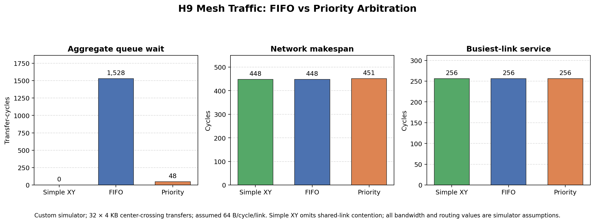

# H9 Center-Bisection Queue Policy Comparison

## Summary

This report compares a simple distance-only XY baseline with FIFO and priority arbitration in the custom `tilepro64` simulator's H9 network experiment. All three replay the same 32-transfer trace over an 8 × 8 mesh. Priority greatly reduces the arbitration model's aggregate queue-wait metric, but it does **not** improve this trace's makespan: makespan increases slightly from 448 to 451 cycles.

The separate simultaneous path-clash stress case is documented in [H9_Worst_Case_Report.md](H9_Worst_Case_Report.md), with its own graph.

These are simulator results under assumed link bandwidth and synthetic priorities. They are not measurements of physical TILEPro64 hardware.

## What the experiment models

The H9 implementation is in `src/benchmark_map.c` (`run_benchmark_h9`). The workload creates 32 transfers, each 4 KB, from the left side of the mesh to the right side. Each route crosses the vertical center cut. Transfer sources are `(x,y)` for `x = 0..3`, and destinations are `(7-x,y)`, for each row `y = 0..7`.

The simulator uses deterministic XY routing over 112 mesh links. A link serves 64 bytes per cycle, so each 4 KB transfer takes 64 service cycles on every hop. Links arbitrate independently each cycle:

- **Simple XY baseline** uses those same routes and per-transfer service times, but times transfers independently. It omits shared-link contention and arbitration. This is a distance/routing baseline, not a contention-aware network simulation.

- **FIFO** chooses the eligible transfer with the lowest transfer ID.
- **Priority** chooses the eligible transfer with the highest synthetic priority (1 through 8, repeated), with transfer ID as a tie-breaker.

The model is store-and-forward: a transfer starts its next hop after completing the current hop. It does not model packet flits, pipelining between hops, router buffers, backpressure, adaptive routing, or separate full-duplex link directions.

## Results

Values below are from the `h9` rows in `results/raw_results.csv`.



| Policy | Aggregate queued transfer cycles | Network makespan | Busiest-link service | Transfers |
|---|---:|---:|---:|---:|
| Simple XY (no contention) | 0 | 448 cycles | 256 cycles of aggregate demand | 32 |
| FIFO | 1,528 | 448 cycles | 256 cycles | 32 |
| Priority | 48 | 451 cycles | 256 cycles | 32 |

Priority reduces the aggregate queue-wait metric by **96.9%**:

\[\frac{1528-48}{1528}\times100\approx96.9\%.\]

Makespan increases by **3 cycles**, or about **0.67%**. The busiest-link service stays at 256 cycles under both policies, consistent with four 4 KB transfers each requiring 64 cycles on the central link in a row. The priority policy changes which transfers receive service first; it does not reduce the amount of work on the bottleneck link.

## Interpretation

The result supports a limited conclusion: **priority arbitration can reduce aggregate waiting for the high-priority mix encoded in this trace.** It does not show that priority improves overall completion time. In this experiment, the FIFO and no-contention simple baseline complete in 448 cycles, while priority takes 451 cycles. The simple baseline omits contention by definition, so its queue-wait value is zero and should not be interpreted as a realistic prediction under simultaneous traffic.

Queue wait is summed over transfers, while makespan is the time when the last transfer completes. Those metrics answer different questions. Priority can help some transfers substantially while making the final transfer finish later. A production scheduler would need a documented urgency rule and likely a starvation safeguard, plus measurements of tail latency, per-priority delay, throughput, and fairness.

## Assumptions and limitations

1. **Bandwidth is assumed:** 64 bytes per cycle per modeled link. The project has no physical TILEPro64 measurement for this value.
2. **Traffic is synthetic:** 32 fixed transfers are used; a real program may generate a different spatial and temporal traffic pattern.
3. **Priority is synthetic:** values 1–8 repeat by transfer index; they are not computed from task deadlines or a measured critical path.
4. **Routing is fixed:** deterministic XY routing is used, with no alternate-route selection.
5. **Link direction is simplified:** the 112 link identifiers represent undirected mesh neighbor pairs; opposite-direction traffic shares the same modeled service resource.
6. **Service is store-and-forward:** links do not pipeline a transfer across consecutive hops.
7. **Queue-delay accounting is aggregate:** it sums waiting cycles across active transfers. In the CSV, H9's `simulated_communication_cost` duplicates `congestion_queue_cycles`; interpret the latter as the named queue-wait metric.

Because of these assumptions, the result is a policy demonstration, not a calibrated prediction of actual TILEPro64 performance.

## Reproducing the comparison

From the `tilepro64` directory:

```sh
bin/tilepro64 --benchmark h9 --scheduler fifo --csv
bin/tilepro64 --benchmark h9 --scheduler priority --csv
bin/tilepro64 --benchmark h9 --scheduler simple --csv
bin/tilepro64 --benchmark h9_worst --scheduler simple --csv
bin/tilepro64 --benchmark h9_worst --scheduler fifo --csv
bin/tilepro64 --benchmark h9_worst --scheduler priority --csv
```

On Windows, use `bin/tilepro64.exe` if the shell requires the executable extension. Both runs print the same CSV schema. The full experiment output, including the H9 rows, is in `results/raw_results.csv`.
