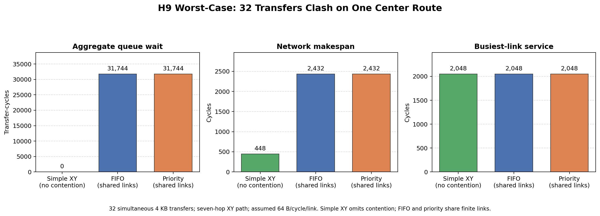

# H9 Worst-Case Path-Clash Comparison

## Scenario

This experiment sends 32 simultaneous 4 KB transfers from tile 24 to tile 31. All follow the same seven-hop XY route across row 3 and share the central link between columns 3 and 4. The assumed link rate is 64 bytes per cycle, so each transfer requires 64 service cycles at each hop.

Three models use this same trace:

- **Simple XY:** keeps the route and per-transfer service time, but computes transfers independently and ignores shared-link contention. It is an idealized lower bound.
- **FIFO:** models finite link capacity and chooses the waiting transfer with the earliest transfer ID at each link.
- **Priority:** models the same capacity and chooses by synthetic priority (1–8, repeated), then transfer ID.



## Results

| Policy | Aggregate queue wait | Makespan | Busiest-link service |
|---|---:|---:|---:|
| Simple XY, no contention | 0 transfer-cycles | 448 cycles | 2,048 cycles of aggregate demand |
| FIFO, contended | 31,744 transfer-cycles | 2,432 cycles | 2,048 cycles |
| Priority, contended | 31,744 transfer-cycles | 2,432 cycles | 2,048 cycles |

The contention-aware makespan is about **5.43 times** the simple baseline (a 442.9% increase). The busiest link must serve all 32 transfers, requiring 32 × 64 = 2,048 service cycles in total. The store-and-forward model pipelines transfers across hops, yielding a 2,432-cycle completion time for the full batch.

FIFO and priority tie because every transfer has the same source, destination, size, and release time. Priority changes which transfer advances first but cannot reduce the required service on the common path. This is a useful worst-case demonstration of path contention, but it does not establish that priority is generally ineffective; different deadlines, routes, and release times could produce a different tradeoff.

## Interpretation and limits

The simple baseline omits the exact effect under study, so its zero queue wait is expected and should be read as a lower bound, not a realistic concurrent-network prediction. The contended policies expose the serialization imposed by the shared center path.

This is a custom simulator experiment, not a hardware measurement. The 64 bytes/cycle rate is an assumption. The model uses undirected shared links, deterministic XY routes, store-and-forward service, synthetic priorities, and no packetization, router buffers, flow control, or adaptive routing. The full rows are available in `results/raw_results.csv` under benchmark `h9_worst`.

## Reproduce

```sh
bin/tilepro64 --benchmark h9_worst --scheduler simple --csv
bin/tilepro64 --benchmark h9_worst --scheduler fifo --csv
bin/tilepro64 --benchmark h9_worst --scheduler priority --csv
python scripts/plot_h9_worst.py
```
